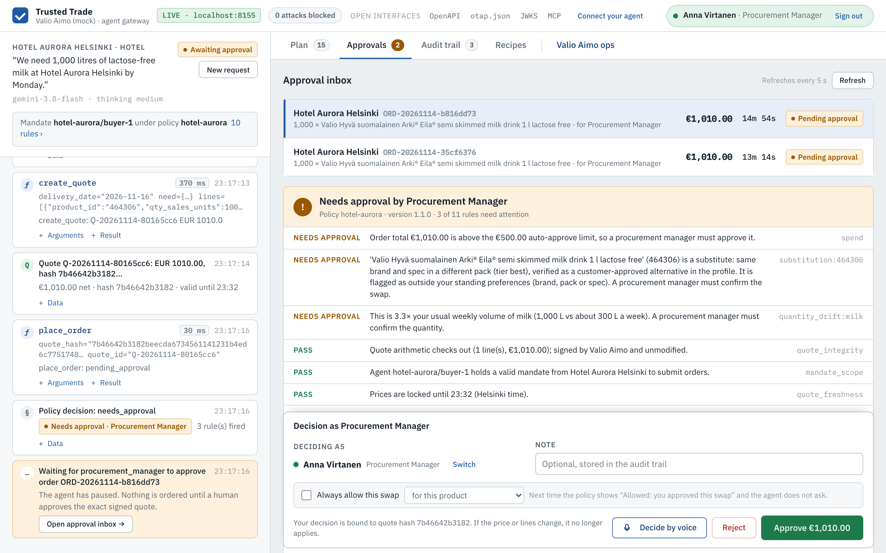

# Valio Aimo: Trusted Trade Agents

**Let any company's AI purchasing agent find, compare, quote and order from Valio Aimo, inside guardrails the customer controls, with every decision signed and explained.**

Built in 48 hours for Junction 2026: the Valio Aimo "Trusted Trade Agents" challenge and the Google DeepMind "Best Use of Gemini API" prize ([docs/GEMINI.md](docs/GEMINI.md)).

> A hotel's agent asks for *"1,000 litres of lactose-free milk at Hotel Aurora Helsinki by Monday."* The usual 10 L box missed its order cut-off (live challenge mock-API data; all challenge data is synthetic), so the gateway plans a same-brand substitute (Valio Eila 1 L, €1,010), signs a fixed-price quote, and the hotel's own policy says **needs approval** for two reasons: over €500 and 3.3× the usual weekly volume (the 1 L pack is the hotel's listed alternative, so the swap itself is allowed). The agent cannot approve; Anna, the procurement manager, signs in and approves that exact quote hash. The order gets a Peppol-style `AP`, and every step is in a signed, hash-chained audit log anyone can verify.


<!-- Live run on main, Sat 14 Nov 23:17 (S5 ui session). More screenshots: docs/reports/frontend/. -->
<sub>Screens in this repo captured before Sun 15 Nov 05:50 show a third reason (the pack swap), which the final policy allows because the 1 L pack is the hotel's listed alternative.</sub>

▶ **Video (110 s):** [narrated walkthrough built from screens of the running system](docs/pitch/demo-walkthrough.mp4) (rebuild: `bash docs/pitch/build_walkthrough.sh`). A real Gemini run, raw and verifiable offline: [docs/evidence/live-run/](docs/evidence/live-run/README.md) (transcript, Gemini trace, signed quote, order, audit chain and JWKS).

## Try it (no keys needed)

```bash
git clone --branch aimo-v1 https://github.com/s1laswang/junction-aimo-agents.git aimo && cd aimo
make accept          # tests, scenarios, conformance and a real order end to end -> RESULT: PASS
uv run aimo serve    # open http://localhost:8000/ui, click Run agent, sign in as Anna with the PIN in data/keys/approver_pin
```

Requires Python 3.11+ and [uv](https://docs.astral.sh/uv/). With no keys, the gateway replays recorded Valio Aimo mock-API responses and a committed catalog subset (`served_from: replay`); a fresh clone with an empty `.env` gives `RESULT: PASS` (17 pass, 0 fail, 3 skip: the two key checks and the live Gemini demo; keyless pytest 270 passed, 0 failed). Add `AIMO_API_KEY` and `GEMINI_API_KEY` to `.env` for the live API and the Gemini agent. The approver PIN (Anna's) is in `data/keys/approver_pin` on the machine running the gateway; other approvers have their own in `data/keys/approver_pins.json`. `aimo-v1` is the judged tag, created at the code freeze (Sun 15 Nov 06:00 Helsinki); before then, clone without `--branch`.

Details: [docs/RUN.md](docs/RUN.md) (keys, keyless vs keyed, **exception matrix**, approving as a human, tests, repo map) · [docs/CONNECT.md](docs/CONNECT.md) (Claude Desktop, Cursor, Gemini CLI, curl walkthrough) · [docs/DEMO.md](docs/DEMO.md) (3-minute demo).

## The challenge's must-haves, and where to check them

| Requirement | How we meet it | Code | Check it |
|---|---|---|---|
| Product, price and availability lookup in structured form | 13 MCP tools and an OpenAPI 3.1 REST API over one service layer; live price and stock with cut-off, partial-stock and out-of-stock issues and provenance; Finnish, Swedish and English search | `aimo/gateway/mcp_server.py`, `aimo/gateway/app.py`, `aimo/backend/client.py`, `aimo/catalog/` | `uv run aimo mcp-check`; `/docs` |
| Inquiry, then an order at fixed prices | `plan_need` → `create_quote` (Ed25519-signed, 15-minute price lock) → `place_order` with the quote hash; unavailable lines refused per line (409) | `aimo/gateway/service.py`, `aimo/trust/signing.py` | `uv run python docs/pitch/qa_milk_flow.py --base http://localhost:8000` |
| Permissions and human approval | A mandate says who may act; the customer's YAML policy says what runs alone (strictest rule wins). Approvals are human-only: the approver signs in (own passphrase → session bound to one person); any agent identity gets 403; approval is bound to the quote hash. Agents cannot move the demo clock or fake stock (`X-Aimo-Now` / `X-Aimo-Faults` ignored for agents unless the operator sets `AIMO_DEMO_FAULTS=1`) | `aimo/trust/policy.py`, `aimo/trust/policies/`, `aimo/gateway/human_auth.py` | `uv run python docs/pitch/permissions_attack.py` (needs a pending order); `tests/test_human_auth.py` |
| Delivery time and sustainability (optional) | Cut-off and delivery checks, delivery reliability and category CO2 per product | `aimo/catalog/delivery.py`, `aimo/trust/policy.py` | `tests/test_catalog.py` |
| Substitution and exceptions (optional) | Good-better-best with reasons, verified against the catalog; allergens tri-state (unknown is never safe) and blocked already when planning; split orders, price jumps, drift; injection screening of supplier text and the request; stock that drops during approval → 409 re-quote, never a partial order; Gemini quota exhausted → the next model answers (`GEMINI_FALLBACK_MODELS`); operator-only fault injection | `aimo/catalog/substitution.py`, `aimo/catalog/plan.py`, `aimo/trust/screening.py` | `uv run python -m scenarios.run_all` (8/8) |
| Traceability and explainability (optional) | Every request, quote, decision, refusal and order in a hash-chained, signed audit log, rendered as sentences; verify and an offline evidence pack; Peppol T116 order response | `aimo/trust/audit.py`, `aimo/backend/peppol.py` | `curl localhost:8000/v1/audit/verify`; `tests/test_peppol_export.py` |

Measured: 371 tests pass with the full catalog (270 without it, 0 failures either way); 6/6 live Gemini scenarios; 0 policy and 0 allergen violations and 80 of 80 of the scenarios' injection payloads flagged (regex screen, which the shipped gateway runs: 44% recall on our separate 36-payload evaluation set and 0 of 34,159 real supplier texts flagged; the optional Gemini layer (`AIMO_SCREEN_GEMINI=1`, off by default) reaches 94% on that set but flags 42 of 60 normal buyer requests. A flag only sends the order to a human) over 640 Gemini-written scenarios in the wind tunnel (a naive agent: 372, 193 and 0 of 80), re-scored on the final code with committed inputs ([docs/evidence/windtunnel](docs/evidence/windtunnel/README.md)). Every number has its command in [docs/NUMBERS.md](docs/NUMBERS.md).

## Architecture


More: [docs/ARCHITECTURE.md](docs/ARCHITECTURE.md) (components, milk data flow, phased path to production), [docs/TRUST.md](docs/TRUST.md) (trust protocol), [docs/ASSUMPTIONS.md](docs/ASSUMPTIONS.md) (every assumption, its impact and its production replacement), [docs/DECISIONS.md](docs/DECISIONS.md) (each choice and the alternatives we rejected) and [docs/NUMBERS.md](docs/NUMBERS.md) (the command behind every number).

## Openness: what is standard, what is ours

| Standard | Status here |
|---|---|
| **MCP** | Implemented. Spec revision **2026-07-28** via the official `mcp` 2.3.0 SDK (from `uv.lock`). Clients on the `initialize` handshake negotiate up to 2025-11-25. Streamable HTTP and stdio. |
| **OpenAPI 3.1** | Implemented (`/openapi.json`, `/docs`). |
| **JWS / JWK** (RFC 7515, 7517, 7638, 8037) | Implemented. Ed25519 quotes and audit events, JWKS at `/.well-known/jwks.json`. |
| **Peppol BIS Advanced Ordering 3.0** | Partial. Order Response Advanced (T116, UBL 2.3) export at `GET /v1/orders/{id}/peppol-order-response.xml`, with samples in `docs/peppol/`. The default test run checks the PEPPOL-T116 rules (re-implemented) and T116 element names; validation against the UBL 2.3 XSD is an opt-in test (`AIMO_UBL_XSD=…/UBL-OrderResponse-2.3.xsd`, schema not bundled), and the full Peppol schematron was **not** run. Party IDs are placeholders. Order, Order Change and Cancellation are not done, and nothing is connected to a Peppol access point. |
| **GS1 GTIN** | Used for product identity. |
| **AP2 / ACP / UCP** | **Aligned, not implemented.** The quote-hash approval is AP2-style (policy ≈ open mandate, approved quote hash ≈ closed checkout mandate). AP2 v0.2 wants an ECDSA-signed checkout JWT, and our quotes are Ed25519. ACP is consumer and card checkout. UCP's B2B procurement council has no spec yet. |
| **`otap/0.1`** | Ours: discovery, tools, signed quotes, approvals and audit. It is published with a conformance suite (`uv run python -m conformance`) that two different wholesalers pass. It is not a standard yet. Next homes: GS1 Finland, OpenPeppol / State Treasury, UCP B2B. |

## Assumptions (all in [docs/ASSUMPTIONS.md](docs/ASSUMPTIONS.md))

1. **No upstream order API.** Orders go to our mock order service behind the same `BackendClient` interface a SAP adapter would implement.
2. **Customers, policies and approvers are invented**, and thresholds (€500 auto limit, 3× drift, 15% price jump) are illustrative, not validated with Valio.
3. **Agent identity is two headers in the demo** (OAuth 2.1 in production); each human approver has their own generated passphrase, which can only sign in or decide as that person, and each sign-in is bound to them (SSO in production).
4. **Product categories and allergens are inferred** where the data is missing; Gemini readings can only block a product, never clear it.
5. **Mock-API quirks** we measured (availability ignores the requested date, fixed closing times) limit multi-date splits; replay and `AIMO_NOW` keep the demo reproducible after the real cut-off.

## Production next steps

1. **Read-only pilot** with a hotel, a school kitchen and a hospital ward; compare the agent's plans with what humans ordered.
2. **Signed quotes, then orders with every one human-approved**, approvers from the customer's own identity provider; Valio legal confirms whether a signed quote is a binding offer.
3. **SAP and webshop adapter** behind `BackendClient` for contract prices and real available-to-promise; GS1 Synkka as the allergen truth source.
4. **OAuth 2.1 for agents** (spend limits as RFC 9396 `authorization_details`), signing keys in a KMS, audit in WORM storage with anchored chain heads.
5. **Peppol Order / Order Response** through Valio's access point; then relax rules one at a time from audit evidence (allergen rules never relax for schools and hospitals).

Phases, KPIs and risks: [docs/OPENNESS.md](docs/OPENNESS.md) "Production path" and [docs/ARCHITECTURE.md](docs/ARCHITECTURE.md) §5.

## Team

- **Silas Wang** ([s1laswang](https://github.com/s1laswang)): team lead, presenter.
- **Momin** ([Momin010](https://github.com/Momin010)): prior Aimo work, MCP review.
- **Ivar** ([ivarakerholm-wq](https://github.com/ivarakerholm-wq)): domain and UX, customer profiles.
- **Chintufp** ([Chintufp](https://github.com/Chintufp)): pitch, deck, demo video.

Engineering was done with a team of Claude Code agents, each on its own branch, coordinated through [docs/TEAM.md](docs/TEAM.md) and [docs/interfaces.md](docs/interfaces.md). Do not confuse this repo with AfterQuery Canary/Sleeper (`s1laswang/agent-arena`) or HoldUp (`s1laswang/junction-meta-glasses`).
