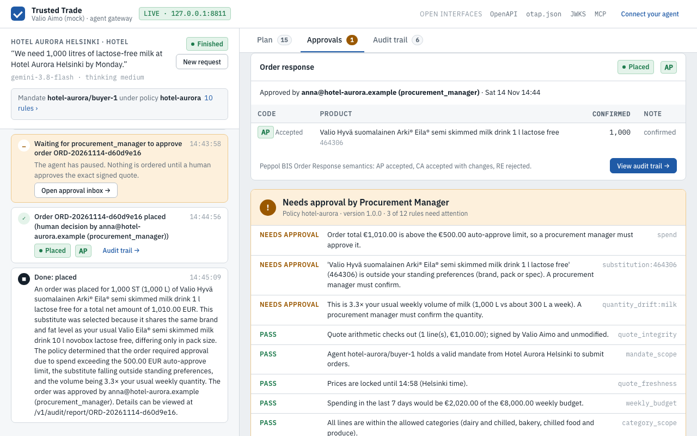

# Valio Aimo: Trusted Trade Agents

**Let any company's AI purchasing agent find, compare, quote and order from Valio Aimo, inside guardrails the customer controls, with every decision signed and explained.**

Built in 48 hours for Junction 2026: the Valio Aimo "Trusted Trade Agents" challenge and the Google DeepMind "Best Use of Gemini API" prize.

> A hotel's agent asks for *"1,000 litres of lactose-free milk at Hotel Aurora Helsinki by Monday."* The usual 10 L dispenser box missed its order cut-off (Thu 12 Nov 15:00, live data from the challenge's mock API; all challenge data is synthetic). The gateway plans a same-brand substitute (Valio Eila 1 L, 464306, €1.01/L, €1,010 total), issues an Ed25519-signed quote, and the hotel's own policy says **needs approval**: €1,010 is over the €500 auto limit and 3.3× the usual weekly milk volume. The procurement manager approves the exact quote hash. The order is placed in our own mock order service (the challenge API has price and availability but no order endpoint) and answered with a Peppol-style response `AP`, and the whole story is in a hash-chained, signed audit log that anyone can verify.


<!-- Screenshot from the frontend engineer's live integration run (team/frontend, Sat 14 Nov 14:45). TODO: re-capture from main after the freeze. -->

## Prerequisites

| Tool | Why | Install |
|---|---|---|
| Python 3.11+ | runtime (`requires-python = ">=3.11"`) | system package or uv-managed |
| [uv](https://docs.astral.sh/uv/) | one-command runner and lockfile installer | `curl -LsSf https://astral.sh/uv/install.sh \| sh` |
| Network | first-run download of the challenge product JSON from the Valio mock API | none |

Environment variables (names only; copy `.env.example` to `.env` and fill them in; never commit `.env`):

| Variable | Required for | If missing |
|---|---|---|
| `AIMO_API_KEY` (alias: `VALIO_API_KEY`) | `aimo serve` / `aimo fetch-data` downloading `data/valio_aimo_junction26_product_data.json` (and the reliability / CO2 CSVs). Needed for the live catalog, catalog-backed pytest cases, `qa_milk_flow.py`, and the conformance suite's catalog-backed checks. | Download is skipped with a warning. `aimo serve` still starts (UI / docs / `/.well-known`). Tests that need the product JSON skip. |
| `AIMO_PORTAL_URL` (alias: `VALIO_API_BASE`), `AIMO_PORTAL_PASSWORD` | mock API base URL (default `https://junction26.valioaimo.fi/`) and portal login to obtain a mock-API key if you do not already have `AIMO_API_KEY` | defaults to the challenge URL; leave password blank if you already have a key |
| `GEMINI_API_KEY` (alias: `GOOGLE_API_KEY`) | live Gemini buyer in `uv run aimo demo`, embeddings / allergen hints, wind-tunnel live runs | `uv run aimo demo` still finishes end-to-end via the deterministic regex parser and scripted buyer fallback (and `make accept` runs it when keyless); `uv run python docs/pitch/qa_milk_flow.py --base http://localhost:8000` runs the REST milk flow (needs the product data + a running gateway); `aimo serve --no-build` skips Gemini catalog builds. |
| `AIMO_APPROVER_PIN` | human approver credential (`X-Approver-Pin`) for `/v1/approvals/{id}/decision`, `/v1/auth/approver-session`, and demo tamper routes | Generated once as a random 12-character passphrase in `data/keys/approver_pin` (mode `0600`); never returned by any API route or MCP tool. |

Do not put real values in the README. A judge machine with none of these variables set can still run `make accept`, which will SKIP key-gated steps and must not crash.

One-command check (keyless steps + documented skips):

```bash
cp .env.example .env    # fill keys if you have them
make accept             # or: uv run bash scripts/judge_accept.sh
```

## Quickstart (one command)

Requirements: see Prerequisites.

```bash
cp .env.example .env    # fill AIMO_PORTAL_URL, AIMO_PORTAL_PASSWORD, AIMO_API_KEY, GEMINI_API_KEY
uv run aimo serve       # downloads the challenge data on first run (needs AIMO_API_KEY), builds the catalog, serves on :8000
```

Without `AIMO_API_KEY` the download is skipped. This checkout's `aimo serve` still binds :8000 so you can open `/ui?mock=1`, `/docs`, `/healthz` and `/.well-known/otap.json`. The live catalog, most tests and the milk-flow script need the downloaded product file.

Then open:

| URL | What |
|---|---|
| http://localhost:8000/ui | Approval UI: agent console, good-better-best cards, policy verdict, approval inbox, audit timeline (`?mock=1` plays the story with no backend) |
| http://localhost:8000/docs | OpenAPI 3.1 REST API (interactive) |
| http://localhost:8000/mcp | MCP server (streamable HTTP), 13 tools |
| http://localhost:8000/.well-known/otap.json | Discovery manifest: endpoints, MCP URL, JWKS URL, policies, standards |
| http://localhost:8000/.well-known/jwks.json | Public key to verify quote and audit signatures |
| http://localhost:8000/healthz | Which components are live vs fallback |

Terminal demo of the Gemini buyer agent, with the gateway running in another terminal:
```bash
uv run aimo demo --auto-approve-as anna@hotel-aurora.example     # 1,000 L milk end to end, about 40 s
uv run aimo demo --scenario stockout|school-allergen|injection|drift|event
uv run aimo demo --montage                                        # all 6 in sequence: 6/6 PASS, $0.034 per order (docs/demo-montage.md)
```
Verified Sat 14 Nov: parse → search → offers → plan (cut-off on 463038, best 464306) → escalation to gemini-4-hydrogen HIGH → signed quote → needs approval (3 reasons) → approved → placed, 38 s.

On first start with `GEMINI_API_KEY` set, `aimo serve` builds the gemini-embedding-2 vectors and the Gemini allergen hints in the background (about 1.5 minutes; full-text search until done). `--build-sync` waits for them, `--no-build` skips them; `uv run python -m aimo.catalog build` builds them by hand.

Tests: `uv run --extra dev pytest -q`. With the challenge product JSON: **591 passed, 7 skipped, 2 xfailed** (600 tests in `tests/`). Without that file, catalog-backed tests skip instead of failing. Acceptance scenarios: `uv run python -m scenarios.run_all` (**8/8** with the live mock API). Conformance suite: `uv run python -m conformance` (**44/44** checks on both Valio Aimo and `toywholesaler`, and offline via `tests/test_openness.py`). Run `uv run aimo fetch-data` (needs `AIMO_API_KEY`) once, then re-run pytest for the catalog-backed count.

## What it is: five pillars

1. **An open door for any agent.** One gateway, two equal surfaces: an **MCP server** (`/mcp`, plus stdio) and an **OpenAPI 3.1** REST API (`/v1`), discoverable from `/.well-known/otap.json`. Every tool calls the live Valio Aimo challenge mock price and availability API (batched up to 1,000 ids, cached 5 minutes, retried with backoff).
2. **Lookup that understands food.** 17,546 products from the challenge's synthetic catalog, with Finnish, Swedish and English names, hybrid full-text plus **gemini-embedding-2** search, content-per-sales-unit parsing (€/L and €/kg), and a **good-better-best** substitution ranking that explains every rank. Allergens are tri-state (contains / free / unknown): **unknown is never safe**, and Gemini-inferred allergens can only block, never clear.
3. **Guardrails the customer owns.** A versioned YAML policy per customer (hotel, school kitchen, hospital): spend thresholds, weekly budget, category scope, substitution tiers, allergen hard blocks, cut-off and delivery checks, standing-order drift and prompt-injection screening. Every rule returns a plain-language reason, and the strictest wins (reject > needs approval > auto).
4. **Signed quotes and human approval bound to the hash.** Quotes are fixed-price for 15 minutes and signed with Ed25519 (JWS, RFC 7515/8037). A named approver in the right role approves *that exact* quote hash; a changed price or an expired lock invalidates the approval. Only a signed-in human can approve. Decisions need a signed per-approver session token (`POST /v1/auth/approver-session` -> `X-Approver-Session`, stored by `/ui` instead of the PIN) or the approver credential (`X-Approver-Pin`, which no API route or MCP tool ever returns; brute-force guesses trigger a per-client 429 `approver_locked` lockout while existing sessions keep working; production: the customer's SSO). Any request carrying agent identity gets 403 `agent_cannot_approve`, even if it names a real approver, and the approver must be in the order customer's directory with an allowed role. MCP has no approval tool at all. Quotes and orders need an explicit caller identity (no defaults), and the inbox is scoped to the caller's customer. The gateway computes each line's substitution tier itself instead of trusting the agent.
5. **An audit trail anyone can check.** Every request, quote, policy decision, approval and order is an event in an append-only, hash-chained, signed log, rendered as readable sentences. `GET /v1/audit/verify` recomputes every hash and signature; the evidence pack lets a third party verify offline.

The reference client is a **Gemini buyer agent** (function calling over our MCP tools, structured-output need parsing, thinking-level escalation for substitution decisions). A **wind tunnel** of Gemini-generated synthetic customers measures it against a naive agent with direct API access. Details: [docs/GEMINI.md](docs/GEMINI.md).

## Architecture


More: [docs/ARCHITECTURE.md](docs/ARCHITECTURE.md) (components, milk data flow, phased path to production), [docs/TRUST.md](docs/TRUST.md) (trust protocol), [docs/ASSUMPTIONS.md](docs/ASSUMPTIONS.md) (every assumption, its impact and its production replacement), [docs/DECISIONS.md](docs/DECISIONS.md) (each choice and the alternatives we rejected) and [docs/NUMBERS.md](docs/NUMBERS.md) (the command behind every number).

## Connect your own agent

The gateway is agent-agnostic. Identity in the demo is two headers (`X-Customer-Id`, `X-Agent-Id`) or, over stdio, the env vars `AIMO_CUSTOMER_ID` / `AIMO_AGENT_ID`. In production this becomes an OAuth 2.1 bearer token per the MCP authorization spec.

MCP tools (13, from `build_mcp().list_tools()`): `search_products`, `get_product`, `get_offers`, `plan_need`, `create_quote`, `place_order`, `get_order_status`, `get_audit_trail`, `list_policies`, `list_recipes`, `plan_recipe`, `check_standing_order_drift`, `propose_offer`. There is deliberately no approval tool: an agent cannot approve its own order.

**Claude Desktop** (`claude_desktop_config.json`, stdio):
```json
{
  "mcpServers": {
    "valio-aimo": {
      "command": "uv",
      "args": ["--directory", "/ABSOLUTE/PATH/TO/junction-aimo-agents", "run", "aimo", "mcp"],
      "env": { "AIMO_CUSTOMER_ID": "hotel-aurora", "AIMO_AGENT_ID": "buyer-1" }
    }
  }
}
```

**Cursor** (`~/.cursor/mcp.json`, streamable HTTP, with `uv run aimo serve` running):
```json
{
  "mcpServers": {
    "valio-aimo": {
      "url": "http://localhost:8000/mcp",
      "headers": { "X-Customer-Id": "hotel-aurora", "X-Agent-Id": "buyer-1" }
    }
  }
}
```

**Gemini CLI** (`~/.gemini/settings.json`, streamable HTTP):
```json
{
  "mcpServers": {
    "valio-aimo": {
      "httpUrl": "http://localhost:8000/mcp",
      "headers": { "X-Customer-Id": "hotel-aurora", "X-Agent-Id": "buyer-1" }
    }
  }
}
```

Check the server from the terminal: `uv run aimo mcp-check` (HTTP) or `uv run aimo mcp-check stdio`. The server advertises 13 tools (the nine trade tools plus `list_recipes`, `plan_recipe`, `check_standing_order_drift` and `propose_offer`). `mcp-check` also calls `search_products` and `get_offers` when the catalog file is present. The three client config snippets follow each client's documented format and have not been tried in those clients yet.

**REST with curl** (the 1,000 L milk flow; every command below was run against a live gateway):
```bash
H=(-H "X-Customer-Id: hotel-aurora" -H "X-Agent-Id: buyer-1" -H "Content-Type: application/json")

# 1. Search (Finnish works too: "laktoositon maito")
curl -s "http://localhost:8000/v1/products/search?q=lactose-free%20milk&limit=5" "${H[@]}"

# 2. Live price and availability: 463038 has cutoff_passed=true, 464306 is in stock at €1.01
curl -s -X POST http://localhost:8000/v1/offers "${H[@]}" \
  -d '{"product_ids":["463038","464306","469363"],"requested_date":"2026-11-16"}'

# 3. Plan: good-better-best plus the order split (best = 464306 x 1000, €1,010)
curl -s -X POST http://localhost:8000/v1/plan "${H[@]}" \
  -d '{"customer_id":"hotel-aurora","product_query":"lactose-free milk","required_claims":["FREE_FROM_LACTOSE"],
       "quantity":1000,"unit":"L","delivery_by":"2026-11-16","preferred_product_ids":["463038"]}'

# 4. Signed quote (live re-priced, fixed for 15 min; the gateway sets tier and flags): note quote_id and quote_hash
curl -s -X POST http://localhost:8000/v1/quotes "${H[@]}" \
  -d '{"delivery_date":"2026-11-16","lines":[{"product_id":"464306","qty_sales_units":1000}]}'

# 5. Order: returns status pending_approval with every rule's reason
curl -s -X POST http://localhost:8000/v1/orders "${H[@]}" -d '{"quote_id":"Q-...","quote_hash":"..."}'

# 6. Human approval, bound to the hash (no X-Agent-Id, or 403 agent_cannot_approve; /ui exchanges the PIN at POST /v1/auth/approver-session for X-Approver-Session, with per-client 429 approver_locked on wrong guesses; wrong hash returns 409 quote_hash_mismatch)
curl -s -X POST http://localhost:8000/v1/approvals/ORD-.../decision \
  -H "Content-Type: application/json" -H "X-Approver-Pin: $AIMO_APPROVER_PIN" \
  -d '{"decision":"approve","approver":"anna@hotel-aurora.example","approver_role":"procurement_manager","quote_hash":"..."}'

# 7. Audit: readable story, and chain verification
curl -s http://localhost:8000/v1/audit/report/ORD-...
curl -s http://localhost:8000/v1/audit/verify
```
The same flow as one script with checks: `uv run python docs/pitch/qa_milk_flow.py --base http://localhost:8000`.

Demo fault injection (header `X-Aimo-Faults` on HTTP and MCP, or env `AIMO_FAULTS`): `stockout:<id|*>`, `partial:<id|*>:<n>`, `price_shock:<id|*>:<factor>`, `cutoff:<id|*>`, `error_rate:<p>`, `rate_limit:<p>`, `latency_ms:<n>`. See [docs/interfaces.md](docs/interfaces.md).

## Openness: what is standard, what is ours

| Standard | Status here |
|---|---|
| **MCP** | Implemented. Spec revision **2026-07-28** via the official `mcp` 2.3.0 SDK (from `uv.lock`). Clients on the `initialize` handshake negotiate up to 2025-11-25. Streamable HTTP and stdio. |
| **OpenAPI 3.1** | Implemented (`/openapi.json`, `/docs`). |
| **JWS / JWK** (RFC 7515, 7517, 7638, 8037) | Implemented. Ed25519 quotes and audit events, JWKS at `/.well-known/jwks.json`. |
| **Peppol BIS Advanced Ordering 3.0** | Partial. Order Response Advanced (T116, UBL 2.3) export at `GET /v1/orders/{id}/peppol-order-response.xml`, with samples in `docs/peppol/`. Validated against the UBL 2.3 XSD and the PEPPOL-T116 rules, **not** the full Peppol schematron. Party IDs are placeholders. Order, Order Change and Cancellation are not done, and nothing is connected to a Peppol access point. |
| **GS1 GTIN** | Used for product identity. |
| **AP2 / ACP / UCP** | **Aligned, not implemented.** The quote-hash approval is AP2-style (policy ≈ open mandate, approved quote hash ≈ closed checkout mandate). AP2 v0.2 wants an ECDSA-signed checkout JWT, and our quotes are Ed25519. ACP is consumer and card checkout. UCP's B2B procurement council has no spec yet. |
| **`otap/0.1`** | Ours: discovery, tools, signed quotes, approvals and audit. It is published with a conformance suite (`uv run python -m conformance`, 44/44 checks) that two different wholesalers pass. It is not a standard yet. Next homes: GS1 Finland, OpenPeppol / State Treasury, UCP B2B. |

## Production next steps

The order is read-only first, then quotes, then orders. Durations and targets are our proposals and have not been checked with Valio.

1. **Read-only pilot** with 3 customers (a hotel, a school kitchen and a hospital ward). Tokens get `catalog:read` only, and humans still order in the webshop. Measure the agent's plan against what the human actually ordered.
2. **Quotes** (`quote:create`). These are signed fixed-price quotes with a 15-minute lock. Valio legal must confirm whether a signed quote is a binding offer under the sales terms.
3. **Orders, every one human-approved** (`order:submit`, with every policy outcome forced to `needs_approval`). Approvers are named in the customer's own identity provider.
4. **Autonomy inside limits.** Relax rules one at a time, using audit evidence. Allergen rules never relax for schools and hospitals.
5. **Integrations.**
   - SAP and webshop behind the existing `BackendClient` seam: contract prices and real available-to-promise.
   - GS1 Synkka as the allergen and net-content truth source, so Gemini hints stay advisory.
   - Buyer agents hosted in kitchen systems (JAMIX, Aromi).
   - Peppol Order / Order Response through Valio's access point.
6. **Identity and keys.**
   - OAuth 2.1 per the MCP authorization spec, with spend limits as RFC 9396 `authorization_details`.
   - Signing keys in a KMS or HSM.
   - Audit to WORM storage with anchored chain heads.

Pilot KPIs:
- zero-correction order rate;
- **0** allergen or policy violations reaching an order;
- escalation precision and recall;
- time from request to order, and approver wait;
- AP / CA / RE mix;
- substitution acceptance;
- 24-hour complaints vs human orders;
- model cost per order.

## Repo map

| Path | What |
|---|---|
| `aimo/gateway/` | FastAPI app (`/v1`, `/.well-known`, `/ui`), MCP server, shared service layer |
| `aimo/backend/` | Valio mock API client (cache, retry, chunking, fault injection), SQLite catalog store, order store with Peppol AP/CA/RE |
| `aimo/catalog/` | Search (FTS5 trigram + gemini-embedding-2, RRF), units, allergens (GS1 to EU14), good-better-best, `plan_need`, Gemini allergen and recipe checks |
| `aimo/trust/` | Policy engine and YAML policies, Ed25519 JWS signing, approvals, hash-chained signed audit, injection screening |
| `aimo/buyer/` | Gemini buyer agent + deterministic regex parser and scripted keyless fallback, tool transports (MCP / in-process / fake), terminal demo, `POST /v1/agent/runs` + SSE |
| `conformance/` | External `otap/0.1` conformance suite (`python -m conformance`, 44/44 checks across discovery, JWKS, OpenAPI, MCP, signed quotes, approvals, Peppol and audit) |
| `toywholesaler/` | Second synthetic wholesaler (*Nordic Bakery Supply*) passing the same 44/44 conformance suite |
| `scenarios/` | End-to-end HTTP acceptance scenarios `s0`..`s7` (`python -m scenarios.run_all`, 8/8) |
| `web/` | No-build approval UI served at `/ui`, with `?mock=1` offline mode |
| `windtunnel/` | Synthetic customers, snapshot replay with faults, oracle, scoring vs a naive baseline |
| `aimo/gemini.py` | One Gemini client plus the usage ledger (`data/gemini/ledger/*.jsonl`) |
| `tests/` | 600 pytest cases across gateway, catalog, trust, buyer, openness and scenarios |
| `docs/` | [OPENNESS](docs/OPENNESS.md), [COMBINE](docs/COMBINE.md), [ASSUMPTIONS](docs/ASSUMPTIONS.md), [DECISIONS](docs/DECISIONS.md), [NUMBERS](docs/NUMBERS.md), [TRUST](docs/TRUST.md), [ARCHITECTURE](docs/ARCHITECTURE.md), [GEMINI](docs/GEMINI.md), [DEMO](docs/DEMO.md), [SUBMISSION](docs/SUBMISSION.md), [interfaces](docs/interfaces.md), [PLAN](docs/PLAN.md) |

Data: the challenge files (product JSON, delivery reliability CSV, CO2 CSV) download into `data/`, which is gitignored together with `.env`, signing keys and the SQLite state.

## Getting the code

The repository is public:

```bash
git clone https://github.com/s1laswang/junction-aimo-agents.git aimo && cd aimo
cp .env.example .env && make accept      # keyless acceptance; add keys to .env for the live mock API and Gemini
```

The final submission will be pinned to the tag `aimo-v1` (created at the Sun 06:00 freeze). Do not confuse this repo with AfterQuery Canary/Sleeper (`s1laswang/agent-arena`) or HoldUp (`s1laswang/junction-meta-glasses`).

## Team

- **Silas Wang** ([s1laswang](https://github.com/s1laswang)): team lead, presenter.
- **Momin** ([Momin010](https://github.com/Momin010)): prior Aimo work, MCP review.
- **Ivar** ([ivarakerholm-wq](https://github.com/ivarakerholm-wq)): domain and UX, customer profiles.
- **Chintufp** ([Chintufp](https://github.com/Chintufp)): pitch, deck, demo video.

Engineering was done with a team of Claude Code agents (gateway, catalog, trust, buyer, frontend, wind tunnel, pitch), each on its own branch, coordinated through [docs/TEAM.md](docs/TEAM.md) and [docs/interfaces.md](docs/interfaces.md).
