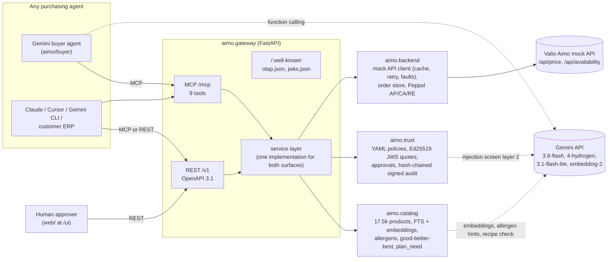

# Valio Aimo: Trusted Trade Agents

**Let any company's AI purchasing agent find, compare, quote and order from Valio Aimo, inside guardrails the customer controls, with every decision signed and explained.**

Built in 48 hours for Junction 2026: the Valio Aimo "Trusted Trade Agents" challenge and the Google DeepMind "Best Use of Gemini API" prize.

> A hotel's agent asks for *"1,000 litres of lactose-free milk at Hotel Aurora Helsinki by Monday."* The usual 10 L dispenser box missed its order cut-off (Thu 12 Nov 15:00, real mock-API data). The gateway plans a same-brand substitute (Valio Eila 1 L, 464306, €1.01/L, €1,010 total), issues an Ed25519-signed quote, and the hotel's own policy says **needs approval**: €1,010 is over the €500 auto limit and 3.3× the usual weekly milk volume. The procurement manager approves the exact quote hash. The order is placed (Peppol response `AP`), and the whole story is in a hash-chained, signed audit log that anyone can verify.


<!-- Screenshot from the frontend engineer's live integration run (team/frontend, Sat 14 Nov 14:45). TODO: re-capture from main after the freeze. -->

## Quickstart (one command)

Requirements: Python 3.11+ and [uv](https://docs.astral.sh/uv/).

```bash
cp .env.example .env    # fill AIMO_PORTAL_URL, AIMO_PORTAL_PASSWORD, AIMO_API_KEY, GEMINI_API_KEY
uv run aimo serve       # downloads the challenge data on first run, builds the catalog, serves on :8000
```

Then open:

| URL | What |
|---|---|
| http://localhost:8000/ui | Approval UI: agent console, good-better-best cards, policy verdict, approval inbox, audit timeline (`?mock=1` plays the story with no backend) |
| http://localhost:8000/docs | OpenAPI 3.1 REST API (interactive) |
| http://localhost:8000/mcp | MCP server (streamable HTTP), 9 tools |
| http://localhost:8000/.well-known/otap.json | Discovery manifest: endpoints, MCP URL, JWKS URL, policies, standards |
| http://localhost:8000/.well-known/jwks.json | Public key to verify quote and audit signatures |
| http://localhost:8000/healthz | Which components are live vs fallback |

Terminal demo of the Gemini buyer agent, with the gateway running in another terminal:
```bash
uv run aimo demo --auto-approve-as anna@hotel-aurora.example     # 1,000 L milk end to end, about 40 s
uv run aimo demo --scenario stockout|school-allergen|injection|drift|event
```
Verified Sat 14 Nov: parse → search → offers → plan (cut-off on 463038, best 464306) → escalation to gemini-4-hydrogen HIGH → signed quote → needs approval (3 reasons) → approved → placed, 38 s.

On first start with `GEMINI_API_KEY` set, `aimo serve` builds the gemini-embedding-2 vectors and the Gemini allergen hints in the background (about 1.5 minutes; full-text search until done). `--build-sync` waits for them, `--no-build` skips them; `uv run python -m aimo.catalog build` builds them by hand.

Tests: `uv run --extra dev pytest -q` (106 passed on main, Sat 14 Nov 15:00).

## What it is: five pillars

1. **An open door for any agent.** One gateway, two equal surfaces: an **MCP server** (`/mcp`, plus stdio) and an **OpenAPI 3.1** REST API (`/v1`), discoverable from `/.well-known/otap.json`. Every tool hits the real Valio Aimo mock price and availability API (batched up to 1,000 ids, cached 5 minutes, retried with backoff).
2. **Lookup that understands food.** 17,546 real products with Finnish, Swedish and English names, hybrid full-text plus **gemini-embedding-2** search, content-per-sales-unit parsing (€/L and €/kg), and a **good-better-best** substitution ranking that explains every rank. Allergens are tri-state (contains / free / unknown): **unknown is never safe**, and Gemini-inferred allergens can only block, never clear.
3. **Guardrails the customer owns.** A versioned YAML policy per customer (hotel, school kitchen, hospital): spend thresholds, weekly budget, category scope, substitution tiers, allergen hard blocks, cut-off and delivery checks, standing-order drift and prompt-injection screening. Every rule returns a plain-language reason, and the strictest wins (reject > needs approval > auto).
4. **Signed quotes and human approval bound to the hash.** Quotes are fixed-price for 15 minutes and signed with Ed25519 (JWS, RFC 7515/8037). A named approver in the right role approves *that exact* quote hash; a changed price or an expired lock invalidates the approval. Agents cannot approve over MCP, by design.
5. **An audit trail anyone can check.** Every request, quote, policy decision, approval and order is an event in an append-only, hash-chained, signed log, rendered as readable sentences. `GET /v1/audit/verify` recomputes every hash and signature; the evidence pack lets a third party verify offline.

The reference client is a **Gemini buyer agent** (function calling over our MCP tools, structured-output need parsing, thinking-level escalation for substitution decisions). A **wind tunnel** of Gemini-generated synthetic customers measures it against a naive agent with direct API access. Details: [docs/GEMINI.md](docs/GEMINI.md).

## Architecture



More: [docs/ARCHITECTURE.md](docs/ARCHITECTURE.md) (components, milk data flow, production path) and [docs/TRUST.md](docs/TRUST.md) (trust protocol).

## Connect your own agent

The gateway is agent-agnostic. Identity in the demo is two headers (`X-Customer-Id`, `X-Agent-Id`) or, over stdio, the env vars `AIMO_CUSTOMER_ID` / `AIMO_AGENT_ID`. In production this becomes an OAuth 2.1 bearer token per the MCP authorization spec.

MCP tools: `search_products`, `get_product`, `get_offers`, `plan_need`, `create_quote`, `place_order`, `get_order_status`, `get_audit_trail`, `list_policies`. There is deliberately no approval tool: an agent cannot approve its own order.

**Claude Desktop** (`claude_desktop_config.json`, stdio):
```json
{
  "mcpServers": {
    "valio-aimo": {
      "command": "uv",
      "args": ["--directory", "/ABSOLUTE/PATH/TO/junction-aimo-agents", "run", "aimo", "mcp"],
      "env": { "AIMO_CUSTOMER_ID": "hotel-aurora", "AIMO_AGENT_ID": "buyer-1" }
    }
  }
}
```

**Cursor** (`~/.cursor/mcp.json`, streamable HTTP, with `uv run aimo serve` running):
```json
{
  "mcpServers": {
    "valio-aimo": {
      "url": "http://localhost:8000/mcp",
      "headers": { "X-Customer-Id": "hotel-aurora", "X-Agent-Id": "buyer-1" }
    }
  }
}
```

**Gemini CLI** (`~/.gemini/settings.json`, streamable HTTP):
```json
{
  "mcpServers": {
    "valio-aimo": {
      "httpUrl": "http://localhost:8000/mcp",
      "headers": { "X-Customer-Id": "hotel-aurora", "X-Agent-Id": "buyer-1" }
    }
  }
}
```

Check the server from the terminal: `uv run aimo mcp-check` (HTTP) or `uv run aimo mcp-check stdio`. Both list the 9 tools and call `search_products` and `get_offers` (verified Sat 14 Nov). The three client config snippets follow each client's documented format and have not been tried in those clients yet.

**REST with curl** (the 1,000 L milk flow; every command below was run against a live gateway):
```bash
H=(-H "X-Customer-Id: hotel-aurora" -H "X-Agent-Id: buyer-1" -H "Content-Type: application/json")

# 1. Search (Finnish works too: "laktoositon maito")
curl -s "http://localhost:8000/v1/products/search?q=lactose-free%20milk&limit=5" "${H[@]}"

# 2. Live price and availability: 463038 has cutoff_passed=true, 464306 is in stock at €1.01
curl -s -X POST http://localhost:8000/v1/offers "${H[@]}" \
  -d '{"product_ids":["463038","464306","469363"],"requested_date":"2026-11-16"}'

# 3. Plan: good-better-best plus the order split (best = 464306 x 1000, €1,010)
curl -s -X POST http://localhost:8000/v1/plan "${H[@]}" \
  -d '{"customer_id":"hotel-aurora","product_query":"lactose-free milk","required_claims":["FREE_FROM_LACTOSE"],
       "quantity":1000,"unit":"L","delivery_by":"2026-11-16","preferred_product_ids":["463038"]}'

# 4. Signed quote (fixed price for 15 min): note quote_id and quote_hash
curl -s -X POST http://localhost:8000/v1/quotes "${H[@]}" \
  -d '{"delivery_date":"2026-11-16","lines":[{"product_id":"464306","qty_sales_units":1000,"tier":"best","flags":["outside_preference"]}]}'

# 5. Order: returns status pending_approval with every rule's reason
curl -s -X POST http://localhost:8000/v1/orders "${H[@]}" -d '{"quote_id":"Q-...","quote_hash":"..."}'

# 6. Human approval, bound to the hash (a wrong hash returns 409 quote_hash_mismatch)
curl -s -X POST http://localhost:8000/v1/approvals/ORD-.../decision "${H[@]}" \
  -d '{"decision":"approve","approver":"anna@hotel-aurora.example","approver_role":"procurement_manager","quote_hash":"..."}'

# 7. Audit: readable story, and chain verification
curl -s http://localhost:8000/v1/audit/report/ORD-...
curl -s http://localhost:8000/v1/audit/verify
```
The same flow as one script with checks: `uv run python docs/pitch/qa_milk_flow.py --base http://localhost:8000`.

Demo fault injection (header `X-Aimo-Faults` on HTTP and MCP, or env `AIMO_FAULTS`): `stockout:<id|*>`, `partial:<id|*>:<n>`, `price_shock:<id|*>:<factor>`, `cutoff:<id|*>`, `error_rate:<p>`, `rate_limit:<p>`, `latency_ms:<n>`. See [docs/interfaces.md](docs/interfaces.md).

## Repo map

| Path | What |
|---|---|
| `aimo/gateway/` | FastAPI app (`/v1`, `/.well-known`, `/ui`), MCP server, shared service layer |
| `aimo/backend/` | Valio mock API client (cache, retry, chunking, fault injection), SQLite catalog store, order store with Peppol AP/CA/RE |
| `aimo/catalog/` | Search (FTS5 trigram + gemini-embedding-2, RRF), units, allergens (GS1 to EU14), good-better-best, `plan_need`, Gemini allergen and recipe checks |
| `aimo/trust/` | Policy engine and YAML policies, Ed25519 JWS signing, approvals, hash-chained signed audit, injection screening |
| `aimo/buyer/` | Gemini buyer agent, need parsing, tool transports (MCP / in-process / fake), terminal demo, `POST /v1/agent/runs` + SSE |
| `web/` | No-build approval UI served at `/ui`, with `?mock=1` offline mode |
| `windtunnel/` | Synthetic customers, snapshot replay with faults, oracle, scoring vs a naive baseline *(landing)* |
| `aimo/gemini.py` | One Gemini client plus the usage ledger (`data/gemini/ledger/*.jsonl`) |
| `tests/` | Offline tests for gateway, catalog, trust and buyer |
| `docs/` | [TRUST](docs/TRUST.md), [ARCHITECTURE](docs/ARCHITECTURE.md), [GEMINI](docs/GEMINI.md), [DEMO](docs/DEMO.md), [SUBMISSION](docs/SUBMISSION.md), [interfaces](docs/interfaces.md), [PLAN](docs/PLAN.md) |

Data: the challenge files (product JSON, delivery reliability CSV, CO2 CSV) download into `data/`, which is gitignored together with `.env`, signing keys and the SQLite state.

## Team

- **Silas Wang** ([s1laswang](https://github.com/s1laswang)): team lead, presenter.
- **Momin** ([Momin010](https://github.com/Momin010)): prior Aimo work, MCP review.
- **Ivar** ([ivarakerholm-wq](https://github.com/ivarakerholm-wq)): domain and UX, customer profiles.
- **Chintufp** ([Chintufp](https://github.com/Chintufp)): pitch, deck, demo video.

Engineering was done with a team of Claude Code agents (gateway, catalog, trust, buyer, frontend, wind tunnel, pitch), each on its own branch, coordinated through [docs/TEAM.md](docs/TEAM.md) and [docs/interfaces.md](docs/interfaces.md).
